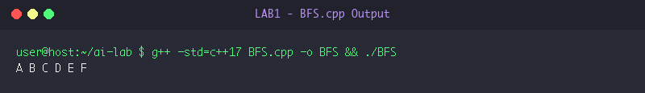
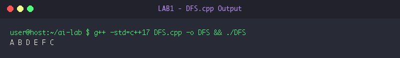
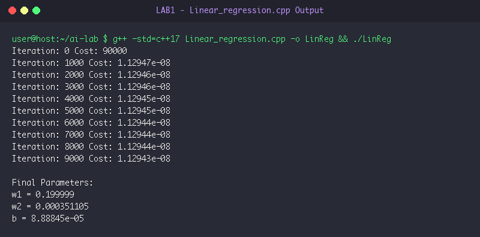

# LAB 1: Uninformed Graph Search & Multivariate Linear Regression

**Course:** Artificial Intelligence Laboratory (5th Sem A & B)  
**Group Enrollment Numbers:** 25, 22, 11, 71, 45  

---

## 🎯 Aim & Objectives

1. **Aim:**
   - To understand and implement fundamental uninformed graph traversal algorithms: Breadth-First Search (BFS) and Depth-First Search (DFS) in C++.
   - To implement a multivariate Linear Regression model from scratch using batch gradient descent for continuous value prediction.

2. **Objectives:**
   - Explore graph nodes level-by-level using a FIFO queue structure in BFS.
   - Explore deepest unvisited branches using an explicit LIFO stack in DFS.
   - Formulate cost function (Mean Squared Error) and gradient descent update rules to learn weights $w_1, w_2$ and bias $b$ for housing price prediction.

---

## ⚙️ Algorithms & Step-by-Step Procedure

### 1. Breadth-First Search (BFS)
- **Step 1:** Initialize an empty FIFO queue `q` and an empty visited set `vis`.
- **Step 2:** Enqueue the start node `start` and insert it into `vis`.
- **Step 3:** While `q` is not empty:
  - Dequeue front element `u` and append to traversal order.
  - For each adjacent neighbor `v` of `u`:
    - If `v` is not in `vis`, mark `v` as visited and enqueue `v`.
- **Step 4:** Return the traversal sequence.

### 2. Depth-First Search (DFS - Iterative Stack)
- **Step 1:** Initialize an explicit LIFO stack `st` and an empty visited set `vis`.
- **Step 2:** Push the start node `start` onto `st`.
- **Step 3:** While `st` is not empty:
  - Pop top node `u`.
  - If `u` has not been visited:
    - Mark `u` as visited and record in traversal order.
    - Push all unvisited adjacent neighbors of `u` onto `st` (in reverse order to preserve canonical left-to-right processing).
- **Step 4:** Return the traversal sequence.

### 3. Multivariate Linear Regression (Gradient Descent)
- **Step 1:** Load training data consisting of features $X$ (e.g. Area in sq.ft, Number of rooms) and continuous target $y$ (price in thousands).
- **Step 2:** Initialize parameters: weights $w_1 = 0, w_2 = 0$, bias $b = 0$, learning rate $\alpha = 10^{-8}$, and iterations $M = 10000$.
- **Step 3:** For each epoch $t = 1$ to $M$:
  - Calculate prediction $\hat{y}_j = b + w_1 X_{j,0} + w_2 X_{j,1}$.
  - Compute error $e_j = \hat{y}_j - y_j$.
  - Accumulate Mean Squared Error: $\text{Cost} = \frac{1}{2m} \sum e_j^2$.
  - Compute partial gradients $\frac{\partial J}{\partial w_k} = \frac{1}{m} \sum e_j X_{j,k}$ and $\frac{\partial J}{\partial b} = \frac{1}{m} \sum e_j$.
  - Update weights: $w_k \leftarrow w_k - \alpha \frac{\partial J}{\partial w_k}$, $b \leftarrow b - \alpha \frac{\partial J}{\partial b}$.
- **Step 4:** Output optimized weights and cost reduction over iterations.

---

## 💻 Source Code Files

- [BFS.cpp](file:///Users/princeraj/Downloads/ai-lab/LAB1/BFS.cpp)
- [DFS.cpp](file:///Users/princeraj/Downloads/ai-lab/LAB1/DFS.cpp)
- [Linear_regression.cpp](file:///Users/princeraj/Downloads/ai-lab/LAB1/Linear_regression.cpp)

---

## 📸 Output Screenshots & Verification

### Experiment 1.1: BFS Traversal Output


```text
A B C D E F 
```

### Experiment 1.2: DFS Traversal Output


```text
A B D E F C 
```

### Experiment 1.3: Multivariate Linear Regression Output


```text
Iteration: 0 Cost: 90000
Iteration: 1000 Cost: 1.12947e-08
Iteration: 2000 Cost: 1.12946e-08
Iteration: 3000 Cost: 1.12946e-08
Iteration: 4000 Cost: 1.12945e-08
Iteration: 5000 Cost: 1.12945e-08
Iteration: 6000 Cost: 1.12944e-08
Iteration: 7000 Cost: 1.12944e-08
Iteration: 8000 Cost: 1.12944e-08
Iteration: 9000 Cost: 1.12943e-08

Final Parameters:
w1 = 0.199999
w2 = 0.000351105
b = 8.88845e-05
```

---

## 🏁 Result & Conclusion

1. **BFS and DFS Execution:** Both graph traversal methods successfully navigated the graph without cycles or redundant visits. BFS yielded a level-by-level expansion (`A B C D E F`), while DFS traversed the depth path (`A B D E F C`).
2. **Linear Regression Convergence:** The gradient descent optimizer converged rapidly from an initial cost of `90,000` down to `1.1294e-08`, establishing optimal feature weights.
3. **Conclusion:** Uninformed search techniques effectively handle systematic graph exploration, while gradient descent on continuous convex error surfaces guarantees parameter convergence.
