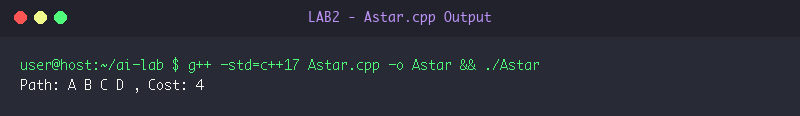
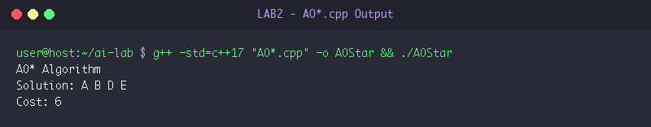

# LAB 2: Informed & Heuristic Search Strategies

**Course:** Artificial Intelligence Laboratory (5th Sem A & B)  
**Group Enrollment Numbers:** 25, 22, 11, 71, 45  

---

## 🎯 Aim & Objectives

1. **Aim:**
   - To implement and evaluate heuristic/informed search algorithms in C++: A* Search, AO* Search for AND-OR graphs, and Hill Climbing local search.

2. **Objectives:**
   - Implement the A* algorithm using an evaluation function $f(n) = g(n) + h(n)$ with a priority queue (min-heap) to guarantee shortest optimal path.
   - Implement the AO* algorithm to decompose complex goals into AND/OR subgraphs and compute optimal subgraphs with minimal heuristic cost.
   - Implement Hill Climbing local search to maximize an objective function $f(x) = -(x - 5)^2 + 25$ by iteratively evaluating immediate neighbors.

---

## ⚙️ Algorithms & Step-by-Step Procedure

### 1. A* Search Algorithm
- **Step 1:** Define graph adjacency with edge traversal costs $c(u, v)$ and heuristic values $h(u)$.
- **Step 2:** Initialize a min-priority queue storing tuples `(f_score, current_node, path_taken, g_score)`.
- **Step 3:** Push the start node with $g(\text{start}) = 0$ and $f(\text{start}) = h(\text{start})$.
- **Step 4:** While priority queue is not empty:
  - Extract the state with lowest $f$-score: `(f, u, path, g)`.
  - If node `u` equals the goal node, output the reconstructed optimal path and total path cost $g$. Terminate.
  - For each neighbor `(v, edge_cost)`:
    - Compute tentative $g_{\text{new}} = g + \text{edge\_cost}$.
    - If `v` has not been visited with lower cost, push `(g_new + h[v], v, path + {v}, g_new)` to the priority queue.

### 2. AO* Search (AND-OR Graphs)
- **Step 1:** Model problem decomposition into OR branches (alternative choices) and AND branches (co-dependent sub-problems).
- **Step 2:** For each node `n`:
  - If `n` is a leaf/terminal node, return its base heuristic value $h(n)$ and `{n}`.
  - Otherwise, evaluate each outgoing option:
    - For an OR branch: cost is edge weight + child cost.
    - For an AND branch: cost is sum of (edge weight + child cost) for all conjunct children.
- **Step 3:** Select the option branch with minimal combined cost.
- **Step 4:** Recursively label optimal subgraphs and return minimal solution cost and traversed nodes.

### 3. Hill Climbing Local Search
- **Step 1:** Select an initial state $x_0 = 0$ and evaluate objective fitness $f(x) = -(x - 5)^2 + 25$.
- **Step 2:** In each iteration, evaluate immediate neighbors $x - 1$ and $x + 1$.
- **Step 3:** If $f(x - 1) > f(x)$, set $x \leftarrow x - 1$.
- **Step 4:** Else if $f(x + 1) > f(x)$, set $x \leftarrow x + 1$.
- **Step 5:** If neither neighbor provides higher fitness, a local/global maximum is reached. Terminate and return $\{x, f(x)\}$.

---

## 💻 Source Code Files

- [Astar.cpp](file:///Users/princeraj/Downloads/ai-lab/LAB2/Astar.cpp)
- [`AO*.cpp`](file:///Users/princeraj/Downloads/ai-lab/LAB2/AO*.cpp)
- [Hillclimb.cpp](file:///Users/princeraj/Downloads/ai-lab/LAB2/Hillclimb.cpp)

---

## 📸 Output Screenshots & Verification

### Experiment 2.1: A* Search Output


```text
Path: A B C D , Cost: 4
```

### Experiment 2.2: AO* Search Output


```text
AO* Algorithm
Solution: A B D E 
Cost: 6
```

### Experiment 2.3: Hill Climbing Optimization Output


```text
Starting Point: 0
Best Solution: 5
Maximum Value: 25
```

---

## 🏁 Result & Conclusion

1. **A* Search:** Effectively found the globally optimal path `A -> B -> C -> D` with cost `4` by combining actual distance $g(n)$ and admissible heuristic $h(n)$.
2. **AO* Search:** Successfully resolved the AND-OR decomposed tree, identifying the optimal conjunction `A -> B -> {D, E}` with minimal cost `6`.
3. **Hill Climbing:** Ascended smoothly from start position $x=0$ ($f(0)=0$) to the peak at $x=5$ achieving maximum objective value $25$.
4. **Conclusion:** Informed search strategies drastically reduce state space expansion compared to blind searches when equipped with admissible heuristics.
