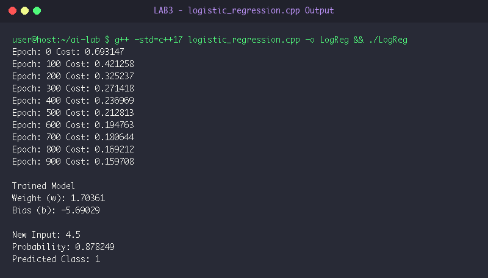

# LAB 3: Logistic Regression & Binary Classification

**Course:** Artificial Intelligence Laboratory (5th Sem A & B)  
**Group Enrollment Numbers:** 25, 22, 11, 71, 45  

---

## 🎯 Aim & Objectives

1. **Aim:**
   - To implement Logistic Regression from scratch in C++ for binary classification using the Sigmoid activation function and Binary Cross-Entropy (Log-Loss).

2. **Objectives:**
   - Implement the sigmoid hypothesis $\sigma(z) = \frac{1}{1 + e^{-z}}$ to map real values to probability interval $[0, 1]$.
   - Compute the binary cross-entropy loss function:
     $$\mathcal{L} = -\frac{1}{n} \sum_{i=1}^n \Big[y^{(i)} \ln(p^{(i)} + \epsilon) + (1 - y^{(i)}) \ln(1 - p^{(i)} + \epsilon)\Big]$$
   - Formulate gradient updates for weight $w$ and bias $b$ to classify discrete classes $\{0, 1\}$.
   - Evaluate decision boundary and test prediction on unseen test input.

---

## ⚙️ Algorithms & Step-by-Step Procedure

### Logistic Regression Model Training
- **Step 1:** Initialize dataset with inputs $X = \{1, 2, 3, 4, 5, 6\}$ and labels $y = \{0, 0, 0, 1, 1, 1\}$.
- **Step 2:** Set parameters: weight $w = 0.0$, bias $b = 0.0$, learning rate $\alpha = 0.1$, and training epochs $= 1000$.
- **Step 3:** For each epoch $e = 0$ to $999$:
  - Initialize accumulators: $dw = 0$, $db = 0$, $\text{cost} = 0$.
  - For each training example $(x_j, y_j)$:
    - Linear projection: $z = w \cdot x_j + b$.
    - Probability activation: $p_j = \sigma(z) = \frac{1}{1 + e^{-z}}$.
    - Accumulate binary cross-entropy loss:
      $$\text{cost} \mathrel{+}= -\Big[y_j \ln(p_j + 10^{-9}) + (1 - y_j) \ln(1 - p_j + 10^{-9})\Big]$$
    - Error gradient: $\text{err}_j = p_j - y_j$.
    - Accumulate gradients: $dw \mathrel{+}= \text{err}_j \cdot x_j$, $db \mathrel{+}= \text{err}_j$.
  - Compute parameter updates:
    $$w \leftarrow w - \alpha \frac{dw}{n}, \quad b \leftarrow b - \alpha \frac{db}{n}$$
  - Periodically display epoch number and normalized cost.
- **Step 4:** Perform inference on new test point $x = 4.5$:
  - Calculate $p = \sigma(w \cdot 4.5 + b)$.
  - Predict class: $1$ if $p \ge 0.5$ else $0$.

---

## 💻 Source Code Files

- [logistic_regression.cpp](file:///Users/princeraj/Downloads/ai-lab/LAB3/logistic_regression.cpp)

---

## 📸 Output Screenshots & Verification

### Experiment 3.1: Logistic Regression Training & Prediction Output


```text
Epoch: 0 Cost: 0.693147
Epoch: 100 Cost: 0.421258
Epoch: 200 Cost: 0.325237
Epoch: 300 Cost: 0.271418
Epoch: 400 Cost: 0.236969
Epoch: 500 Cost: 0.212813
Epoch: 600 Cost: 0.194763
Epoch: 700 Cost: 0.180644
Epoch: 800 Cost: 0.169212
Epoch: 900 Cost: 0.159708

Trained Model
Weight (w): 1.70361
Bias (b): -5.69029

New Input: 4.5
Probability: 0.878249
Predicted Class: 1
```

---

## 🏁 Result & Conclusion

1. **Loss Reduction:** Training error decreased monotonically from initial cross-entropy `0.6931` (random guess) down to `0.1597` after 1000 epochs.
2. **Model Learned Parameters:** Optimal weight converged to $w \approx 1.7036$ and bias $b \approx -5.6903$. The calculated decision boundary threshold is $x^* = -\frac{b}{w} \approx 3.34$.
3. **Inference:** Test sample $x = 4.5$ produced probability $87.82\%$, correctly assigning class label `1`.
4. **Conclusion:** Logistic regression with gradient descent effectively resolves linearly separable binary classification tasks using the sigmoid activation function.
