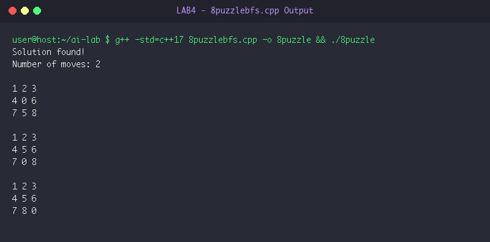
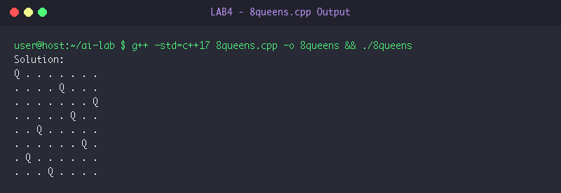
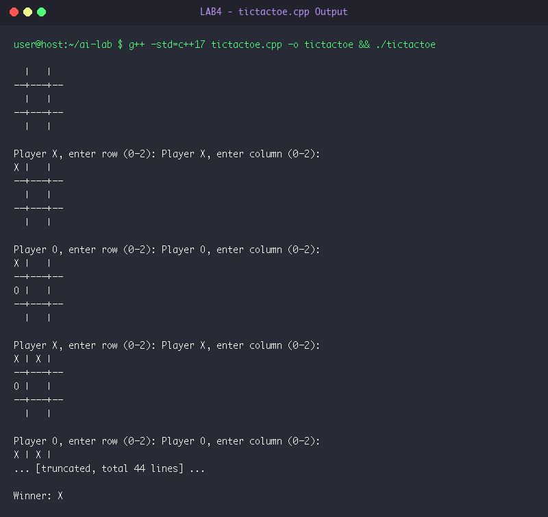

# LAB 4: Classical AI Search & Game State Space Exploration

**Course:** Artificial Intelligence Laboratory (5th Sem A & B)  
**Group Enrollment Numbers:** 25, 22, 11, 71, 45  

---

## 🎯 Aim & Objectives

1. **Aim:**
   - To implement and analyze solutions for classical AI problem formulations:
     - 8-Puzzle Problem using state-space Breadth-First Search (BFS).
     - 8-Queens Constraint Satisfaction Problem using Backtracking.
     - 2-Player Tic-Tac-Toe Game with real-time win/draw validation.

2. **Objectives:**
   - Formulate 8-puzzle board configuration as state vectors, define valid blank tile transitions, and guarantee minimum-step solution path using BFS.
   - Formulate 8-queens problem using recursive backtracking with row, major diagonal, and anti-diagonal conflict checks.
   - Build an interactive terminal-based 2-player game environment with dynamic grid rendering and rule enforcement.

---

## ⚙️ Algorithms & Step-by-Step Procedure

### 1. 8-Puzzle Solver using BFS
- **Step 1:** Represent the $3 \times 3$ puzzle as a flattened 9-element vector, with `0` representing the empty tile.
- **Step 2:** Define target state: `goal = {1, 2, 3, 4, 5, 6, 7, 8, 0}`.
- **Step 3:** Initialize FIFO queue `q` containing pairs of `(current_state, path_of_states)` and a visited set `vis` initialized with `start`.
- **Step 4:** While `q` is not empty:
  - Dequeue front state `s` and its `path`.
  - If `s == goal`, output solution path length and display intermediate board states step-by-step. Terminate.
  - Locate index of `0` in `s`: row $r = \lfloor \text{idx}/3 \rfloor$, column $c = \text{idx} \pmod 3$.
  - For four directions $\Delta r, \Delta c \in \{(-1, 0), (1, 0), (0, -1), (0, 1)\}$:
    - If new coordinate $(r + \Delta r, c + \Delta c)$ is inside $3 \times 3$ bounds:
      - Swap `0` with the neighbor tile to create state $s'$.
      - If $s'$ is not in `vis`: insert into `vis` and enqueue `(s', path + {s'})`.

### 2. 8-Queens Solver using Backtracking
- **Step 1:** Initialize an $8 \times 8$ matrix `b` with all zeros.
- **Step 2:** Define recursive function `solve(b, r, n)` to place queen in row `r`:
  - If row $r == n$, all 8 queens are safely placed. Return `true`.
  - For each column $c = 0$ to $n - 1$:
    - Check safety `is_safe(b, r, c, n)`:
      - Column check: ensure no queen exists in column $c$ for rows $< r$.
      - Upper-left diagonal check: ensure no queen in $(r - k, c - k)$.
      - Upper-right diagonal check: ensure no queen in $(r - k, c + k)$.
    - If safe:
      - Place queen: `b[r][c] = 1`.
      - Recursively call `solve(b, r + 1, n)`. If `true`, return `true`.
      - Backtrack: remove queen `b[r][c] = 0`.
  - Return `false` if no column in row `r` satisfies constraints.

### 3. Interactive Tic-Tac-Toe Game Engine
- **Step 1:** Initialize $3 \times 3$ grid with empty spaces and active player `'X'`.
- **Step 2:** Loop continuously:
  - Render current board layout.
  - Prompt current player for row $(0-2)$ and column $(0-2)$.
  - Validate move: ensure indices within range and target cell is empty.
  - Record player symbol in grid.
  - Check win condition across all 3 rows, 3 columns, and 2 diagonals. If winner detected, declare victory and exit.
  - Check draw condition (grid completely filled). If draw, exit.
  - Switch active player: `player = (player == 'X' ? 'O' : 'X')`.

---

## 💻 Source Code Files

- [8puzzlebfs.cpp](file:///Users/princeraj/Downloads/ai-lab/LAB4/8puzzlebfs.cpp)
- [8queens.cpp](file:///Users/princeraj/Downloads/ai-lab/LAB4/8queens.cpp)
- [tictactoe.cpp](file:///Users/princeraj/Downloads/ai-lab/LAB4/tictactoe.cpp)

---

## 📸 Output Screenshots & Verification

### Experiment 4.1: 8-Puzzle BFS Solver Output


```text
Solution found!
Number of moves: 2

1 2 3
4 0 6
7 5 8

1 2 3
4 5 6
7 0 8

1 2 3
4 5 6
7 8 0
```

### Experiment 4.2: 8-Queens Backtracking Output


```text
Solution:
Q . . . . . . . 
. . . . Q . . . 
. . . . . . . Q 
. . . . . Q . . 
. . Q . . . . . 
. . . . . . Q . 
. Q . . . . . . 
. . . Q . . . . 
```

### Experiment 4.3: Tic-Tac-Toe Game Output


```text
X | X | X
--+---+--
O | O |  
--+---+--
  |   |  

Winner: X
```

---

## 🏁 Result & Conclusion

1. **8-Puzzle:** BFS systematically discovered the optimal sequence of 2 moves to reach the goal configuration without redundant state cycles.
2. **8-Queens:** Backtracking efficiently pruned illegal configurations, converging rapidly to a valid placement with zero mutual queen attacks.
3. **Tic-Tac-Toe:** Interactive console loop enforced all rules and correctly flagged winning horizontal sequences.
4. **Conclusion:** State-space BFS guarantees shortest-move paths in unweighted discrete puzzles, while recursive backtracking provides powerful search space pruning for constraint satisfaction problems.
