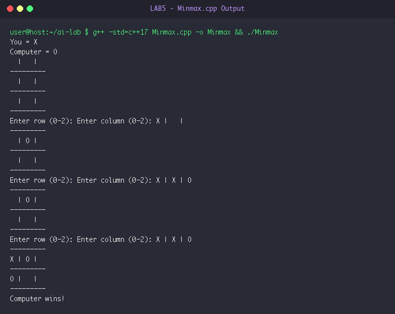

# LAB 5: Adversarial Search & Game Playing (Minimax Algorithm)

**Course:** Artificial Intelligence Laboratory (5th Sem A & B)  
**Group Enrollment Numbers:** 25, 22, 11, 71, 45  

---

## 🎯 Aim & Objectives

1. **Aim:**
   - To implement the Minimax algorithm for optimal decision-making in a two-player zero-sum game (Tic-Tac-Toe AI vs Human).

2. **Objectives:**
   - Construct recursive game tree search where the AI maximizes utility while anticipating the opponent will minimize utility.
   - Define static utility evaluations: $+1$ for AI win (`'O'`), $-1$ for Human win (`'X'`), and $0$ for draw.
   - Implement `best_move()` generator that selects optimal grid coordinates guaranteeing no defeat against an optimal player.

---

## ⚙️ Algorithms & Step-by-Step Procedure

### Minimax Algorithm for Tic-Tac-Toe
- **Step 1:** Define terminal board evaluation:
  - If AI (`'O'`) wins: return $+1$.
  - If Human (`'X'`) wins: return $-1$.
  - If board is full: return $0$ (draw).
- **Step 2:** Define recursive function `minimax(board, is_maximizing)`:
  - Check if current board is in terminal state; if so, return evaluated utility.
  - If `is_maximizing == true` (AI's turn):
    - Initialize `best_score = -infinity`.
    - For each empty cell $(r, c)$ in board:
      - Temporarily place symbol `'O'`.
      - Compute score: `score = minimax(board, false)`.
      - Undo move: revert cell $(r, c)$ to empty `' '`.
      - Update `best_score = max(best_score, score)`.
    - Return `best_score`.
  - Else (`is_maximizing == false`, Human's turn):
    - Initialize `best_score = +infinity`.
    - For each empty cell $(r, c)$ in board:
      - Temporarily place symbol `'X'`.
      - Compute score: `score = minimax(board, true)`.
      - Undo move: revert cell $(r, c)$ to empty `' '`.
      - Update `best_score = min(best_score, score)`.
    - Return `best_score`.
- **Step 3:** To choose AI's move (`best_move`):
  - Iterate across all available cells, simulate move `'O'`, evaluate via `minimax(board, false)`, and select coordinate yielding highest utility score.
- **Step 4:** Execute main game loop: Human enters move, AI responds with optimal minimax move, until terminal win or draw.

---

## 💻 Source Code Files

- [Minmax.cpp](file:///Users/princeraj/Downloads/ai-lab/LAB5/Minmax.cpp)

---

## 📸 Output Screenshots & Verification

### Experiment 5.1: Minimax AI Game Playing Output


```text
You = X
Computer = O
  |   |  
---------
  |   |  
---------
  |   |  
---------
Enter row (0-2): Enter column (0-2): X |   |  
---------
  | O |  
---------
  |   |  
---------
Enter row (0-2): Enter column (0-2): X | X | O
---------
  | O |  
---------
  |   |  
---------
Enter row (0-2): Enter column (0-2): X | X | O
---------
X | O |  
---------
O |   |  
---------
Computer wins!
```

---

## 🏁 Result & Conclusion

1. **Game Tree Evaluation:** The Minimax algorithm successfully evaluated all plausible game branches from current configurations.
2. **AI Optimality:** When the human player placed moves, the computer strategically occupied the center and blocked diagonal threats, ultimately securing the victory along the diagonal.
3. **Conclusion:** The Minimax algorithm provides an optimal strategy for finite, deterministic, perfect-information zero-sum games, guaranteeing the AI achieves the highest possible payoff against any opponent.
