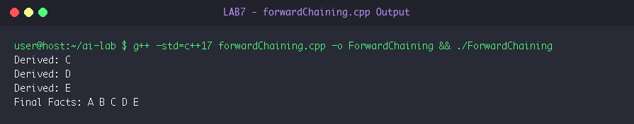
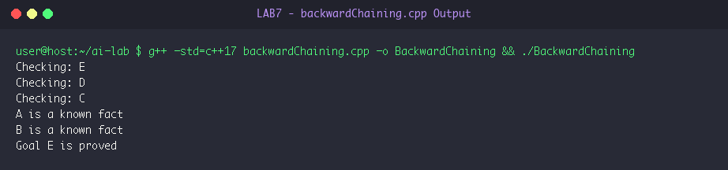

# LAB 7: Knowledge Representation & Rule-Based Inference Engines

**Course:** Artificial Intelligence Laboratory (5th Sem A & B)  
**Group Enrollment Numbers:** 25, 22, 11, 71, 45  

---

## 🎯 Aim & Objectives

1. **Aim:**
   - To implement propositional rule-based inference engines in C++: Forward Chaining (data-driven reasoning) and Backward Chaining (goal-directed deduction).

2. **Objectives:**
   - Implement Forward Chaining to start with a known knowledge base of facts and repeatedly apply inference rules to deduce all reachable conclusions.
   - Implement Backward Chaining to start with a target hypothesis/goal and recursively prove all necessary antecedent sub-goals.
   - Compare data-driven inference versus goal-directed proof strategies.

---

## ⚙️ Algorithms & Step-by-Step Procedure

### Knowledge Base & Rule Setup
- **Known Initial Facts:** $\{\text{"A"}, \text{"B"}\}$
- **Inference Rules (Horn Clauses):**
  1. $\text{Rule 1:} \quad \text{"A"} \land \text{"B"} \implies \text{"C"}$
  2. $\text{Rule 2:} \quad \text{"C"} \implies \text{"D"}$
  3. $\text{Rule 3:} \quad \text{"D"} \implies \text{"E"}$

### 1. Forward Chaining (Data-Driven)
- **Step 1:** Initialize working memory `facts` with known base facts: `{"A", "B"}`.
- **Step 2:** Loop until no new facts can be added (fixed-point reached):
  - Set `added = false`.
  - For each rule `(conditions, result)` in rule base:
    - Check if `result` is NOT yet in `facts`.
    - Check if `conditions` is a subset of `facts` (using `std::includes`).
    - If satisfied:
      - Add `result` to `facts`.
      - Output newly derived conclusion.
      - Set `added = true`.
  - If `added == false`, terminate loop.
- **Step 3:** Print final derived knowledge base facts.

### 2. Backward Chaining (Goal-Driven)
- **Step 1:** Specify target goal to prove (e.g. goal = `"E"`).
- **Step 2:** Define recursive function `backward_chaining(goal)`:
  - If `goal` is already present in known `facts`:
    - Output `goal is a known fact` and return `true`.
  - For each rule `(conditions, result)` where `result == goal`:
    - Output `Checking: goal`.
    - Set `all_conditions_met = true`.
    - For each antecedent condition `c` in `conditions`:
      - Recursively call `backward_chaining(c)`.
      - If recursive check returns `false`, set `all_conditions_met = false` and break.
    - If `all_conditions_met == true`, return `true`.
  - Return `false` (goal cannot be proved).
- **Step 3:** If function returns `true`, declare `Goal E is proved`.

---

## 💻 Source Code Files

- [forwardChaining.cpp](file:///Users/princeraj/Downloads/ai-lab/LAB7/forwardChaining.cpp)
- [backwardChaining.cpp](file:///Users/princeraj/Downloads/ai-lab/LAB7/backwardChaining.cpp)

---

## 📸 Output Screenshots & Verification

### Experiment 7.1: Forward Chaining Output


```text
Derived: C
Derived: D
Derived: E
Final Facts: A B C D E 
```

### Experiment 7.2: Backward Chaining Output


```text
Checking: E
Checking: D
Checking: C
A is a known fact
B is a known fact
Goal E is proved
```

---

## 🏁 Result & Conclusion

1. **Forward Chaining:** Successfully fired Rule 1 to infer fact `C`, then Rule 2 to infer `D`, and Rule 3 to infer `E`, expanding known facts to `A B C D E`.
2. **Backward Chaining:** Starting at target goal `E`, successfully decomposed into sub-goal `D`, then sub-goal `C`, and grounded into known base facts `A` and `B`, rigorously proving `Goal E is proved`.
3. **Conclusion:** Forward chaining is optimal when lots of data is available and all possible consequences are desired, whereas backward chaining is highly efficient for targeted query answering and diagnosis systems.
