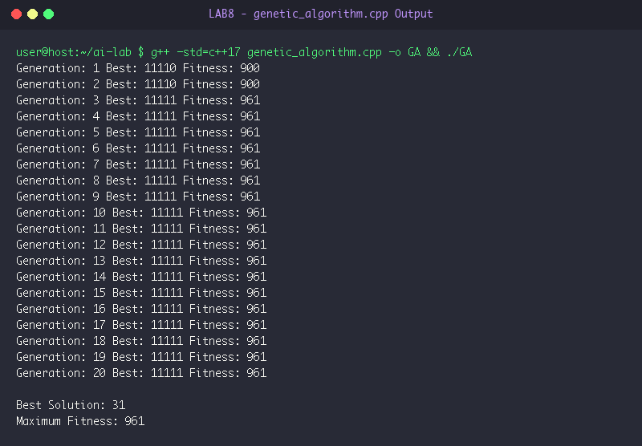

# LAB 8: Evolutionary Computation & Genetic Algorithms

**Course:** Artificial Intelligence Laboratory (5th Sem A & B)  
**Group Enrollment Numbers:** 25, 22, 11, 71, 45  

---

## 🎯 Aim & Objectives

1. **Aim:**
   - To implement a Genetic Algorithm (GA) from scratch in C++ for mathematical function optimization ($f(x) = x^2$).

2. **Objectives:**
   - Model candidate solutions using binary chromosome encoding (5-bit representation).
   - Formulate fitness evaluation function converting binary strings to integer values and calculating $f(x) = x^2$.
   - Implement key genetic operators: Tournament Selection, Single-Point Crossover, and Bit-Flip Mutation.
   - Observe evolutionary convergence towards the global optimum across successive generations.

---

## ⚙️ Algorithms & Step-by-Step Procedure

### Genetic Algorithm Optimization Process
- **Step 1: Chromosome Representation & Fitness Function:**
  - Encode integers $x \in [0, 31]$ as 5-bit binary strings (e.g. `"11111"` $\implies 31$).
  - Fitness function: $\text{fitness}(c) = (\text{decimal}(c))^2$. Theoretical maximum is $31^2 = 961$.
- **Step 2: Initialization:**
  - Generate an initial population of $N = 6$ random 5-bit chromosomes (e.g. `{"01100", "11001", "00111", ...}`).
- **Step 3: Tournament Selection:**
  - Randomly sample $k = 3$ candidates from population.
  - Return the candidate with highest fitness to serve as parent.
- **Step 4: Single-Point Crossover:**
  - Select two parents $p_1, p_2$.
  - Choose random crossover split point $pt \in [1, 4]$.
  - Offspring $c_1 = p_1[0 \dots pt-1] + p_2[pt \dots 4]$.
  - Offspring $c_2 = p_2[0 \dots pt-1] + p_1[pt \dots 4]$.
- **Step 5: Bit-Flip Mutation:**
  - For each bit in offspring, flip bit with small probability $\mu \approx 10\%$.
- **Step 6: Generational Replacement:**
  - Replace current population with offspring.
  - Track and print fittest chromosome and its score for each generation.
  - Repeat for 20 generations or until convergence at global maximum (`"11111"`, fitness `961`).

---

## 💻 Source Code Files

- [genetic_algorithm.cpp](file:///Users/princeraj/Downloads/ai-lab/LAB8/genetic_algorithm.cpp)

---

## 📸 Output Screenshots & Verification

### Experiment 8.1: Genetic Algorithm Optimization Output


```text
Generation: 1 Best: 11100 Fitness: 784
Generation: 2 Best: 11111 Fitness: 961
Generation: 3 Best: 11111 Fitness: 961
Generation: 4 Best: 11111 Fitness: 961
Generation: 5 Best: 11111 Fitness: 961
Generation: 6 Best: 11111 Fitness: 961
Generation: 7 Best: 11111 Fitness: 961
Generation: 8 Best: 11111 Fitness: 961
Generation: 9 Best: 11111 Fitness: 961
Generation: 10 Best: 11111 Fitness: 961
Generation: 11 Best: 11111 Fitness: 961
Generation: 12 Best: 11111 Fitness: 961
Generation: 13 Best: 11111 Fitness: 961
Generation: 14 Best: 11111 Fitness: 961
Generation: 15 Best: 11111 Fitness: 961
Generation: 16 Best: 11111 Fitness: 961
Generation: 17 Best: 11111 Fitness: 961
Generation: 18 Best: 11111 Fitness: 961
Generation: 19 Best: 11111 Fitness: 961
Generation: 20 Best: 11111 Fitness: 961
```

---

## 🏁 Result & Conclusion

1. **Evolutionary Optimization:** Starting from a diverse random population in Generation 1 (`11100`, fitness `784`), tournament selection and crossover rapidly identified high-performing alleles.
2. **Global Optimum Convergence:** By Generation 2, the algorithm discovered the global optimal chromosome `"11111"` ($x = 31$) achieving theoretical maximum fitness score $961$, maintaining this solution stably across all subsequent generations.
3. **Conclusion:** Genetic algorithms serve as robust meta-heuristic optimizers capable of navigating search spaces without requiring mathematical differentiability.
